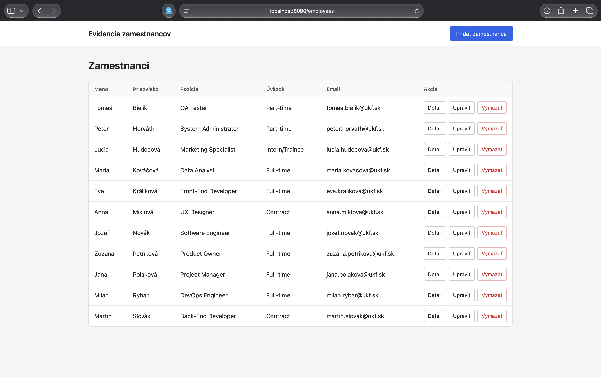
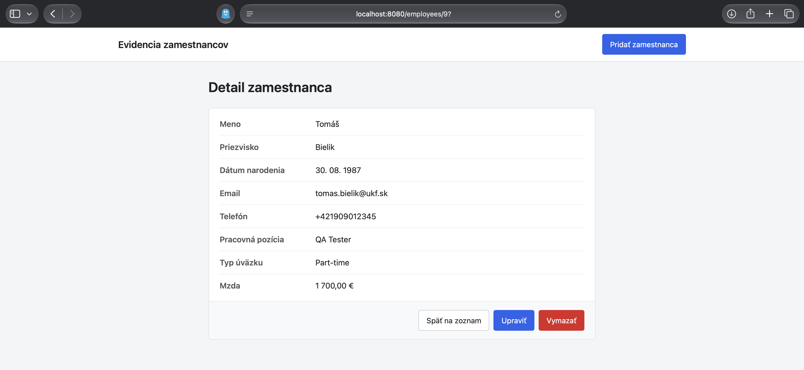
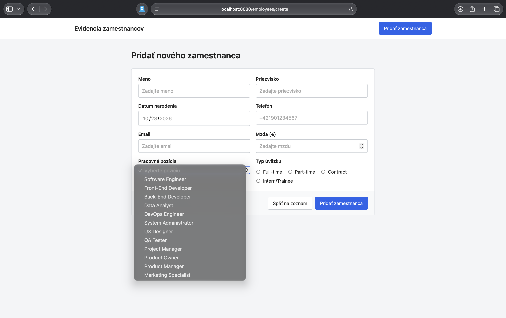

# Zadanie 5 – Spring Boot MVC CRUD

## Zoznam všetkých zamestnancov

## Detail zamestnanca

## Formulár

## Databáza

- `database/1_employee_directory.sql` – pôvodná databáza zo seminára.
- `database/2_migration_full_time.sql` – stĺpec `full_time` bol v pôvodnej databáze typu `tinyint` (1/0). Zadanie vyžaduje 4 hodnoty z radio buttonov (Full-time, Part-time, Contract, Intern/Trainee), preto skript mení stĺpec na `VARCHAR` a prevedie existujúce dáta: 1 → Full-time, 0 → Part-time.
